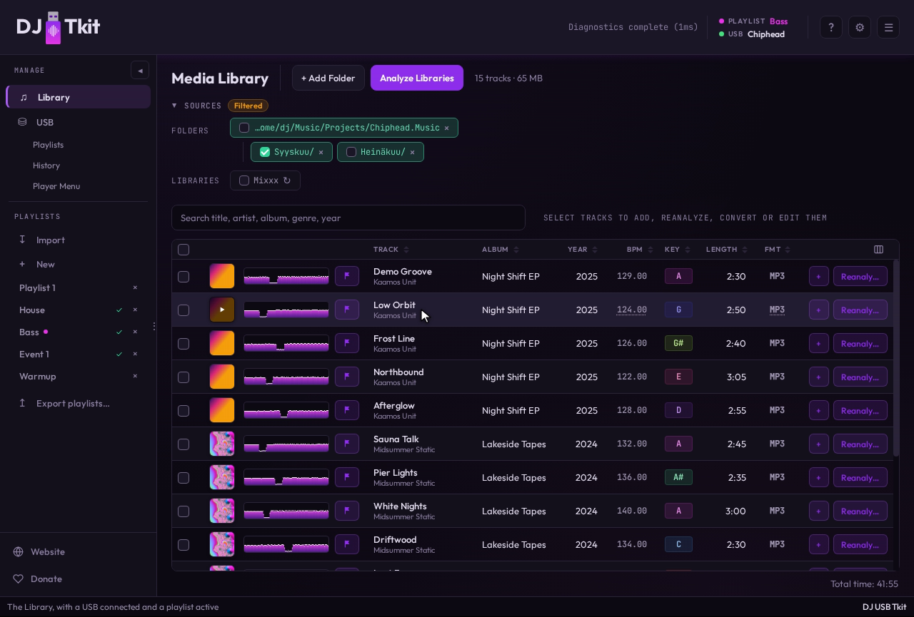
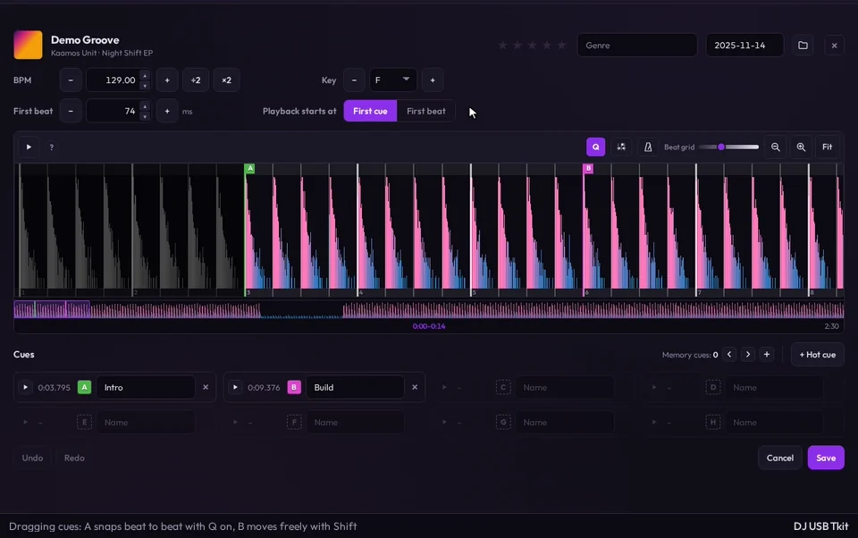

# DJ USB Tkit

Local-first DJ library manager — scan, analyze and export playlists to USB for Pioneer CDJ/XDJ, rekordbox and Engine DJ players (Denon, Numark), converting FLAC, ALAC, OGG and Opus to MP3, AIFF or WAV for players that can't read them, and repair broken USB drives. Built with Rust + Tauri.

Prebuilt installers for macOS, Windows, and Linux are on the [Releases](https://github.com/haivala/dj-usb-tkit/releases) page.

<p align="center">
  <picture>
    <source media="(prefers-color-scheme: light)" srcset="docs/assets/DJ-USB-Tkit-light.png" />
    
  </picture>
</p>

## Installing a Prebuilt Release

### macOS

The `.dmg` builds are not signed with an Apple Developer certificate or notarized,
so Gatekeeper will refuse to open the app on first launch ("DJ USB Tkit is damaged
and can't be opened" or "the developer cannot be verified").

To run it:

1. Open the `.dmg` and drag **DJ USB Tkit** to `/Applications`.
2. Clear the extended attributes macOS added to the download:

   ```bash
   xattr -cr "/Applications/DJ USB Tkit.app"
   ```

3. Launch the app normally. If you skipped step 2, you can instead right-click
   (or Control-click) the app icon, choose **Open**, and confirm once — but the
   `xattr` command is the reliable fix on Apple Silicon.

This only needs to be done once per installed version. Building from source (see
below) also avoids the prompt.

### Linux

Download the `.AppImage`, `.deb`, or `.rpm` from the Releases page. The prebuilt
packages need glibc 2.35 or newer (Ubuntu 22.04, Linux Mint 21, Debian 12,
Fedora 36, or later).

For the AppImage, make it executable and run it:

```bash
chmod +x DJ_USB_Tkit_*_amd64.AppImage
./DJ_USB_Tkit_*_amd64.AppImage
```

On Arch Linux, install [`dj-usb-tkit-bin`](https://aur.archlinux.org/packages/dj-usb-tkit-bin)
from the AUR with your AUR helper, and update it the same way:

```bash
yay -S dj-usb-tkit-bin
```

If rekordbox runs under Wine, use this Linux build, not the Windows one: the
Windows build's interface (WebView2) stays blank under Wine. The Linux build
finds rekordbox's library in `$WINEPREFIX`, `~/.wine`, or a Bottles bottle.
For a prefix somewhere else, start the app with `WINEPREFIX=/path/to/prefix`
(see [docs/EXTERNAL_LIBRARIES.md](docs/EXTERNAL_LIBRARIES.md)).

If the window stays blank or black, or the app closes right after it opens,
start it with `WEBKIT_DISABLE_DMABUF_RENDERER=1` in front of the command. The
app then draws on the CPU, which uses more CPU during long exports and
analysis runs.

## Features

- **Library**: scan your music folders, build playlists, and play tracks in
  the app.
- **Analysis**: BPM, key, waveforms and artwork for tracks that lack them
  (see [docs/LIBRARY_ANALYSIS.md](docs/LIBRARY_ANALYSIS.md)).
- **Cue editor**: hot cues, memory cues, beat grid, key, genre, rating and
  where the CDJ starts playback, from the library or straight on a connected
  USB, with a metronome to check the grid by ear (see
  [docs/CUE_EDITOR.md](docs/CUE_EDITOR.md)).
- **rekordbox and Mixxx import**: tracks, playlists and hot cues from a library
  on the same computer (see [docs/EXTERNAL_LIBRARIES.md](docs/EXTERNAL_LIBRARIES.md)).
- **USB export and import** for Pioneer CDJ/XDJ and rekordbox, in `mirror` or
  `additive` sync mode. Each USB keeps its name across replugs and computers
  (see [docs/USB_EXPORT.md](docs/USB_EXPORT.md) and
  [docs/USB_CONNECT.md](docs/USB_CONNECT.md)).
- **Transcodes**: FLAC, ALAC, WAV, AIFF, OGG and Opus tracks converted to MP3
  320, AIFF or WAV for players that can't read them, kept on the same track
  with its cues and playlists (see [docs/TRANSCODES.md](docs/TRANSCODES.md)).
- **Engine DJ** library on the USB for Denon and Numark players, so they get
  the app's beat grids and waveforms (see [docs/ENGINE_DJ.md](docs/ENGINE_DJ.md)).
- **Diagnostics and repair** for broken USB databases, with a preview before
  anything is written (see [docs/DIAGNOSTICS_REPAIRS.md](docs/DIAGNOSTICS_REPAIRS.md)).
- **Backups** of the USB databases before every write, which you can restore
  from the Backups panel (see [docs/USB_BACKUPS.md](docs/USB_BACKUPS.md)).

<p align="center">
  
</p>

Everything runs locally: no cloud service is needed for any of it. The full
documentation starts at [docs/README.md](docs/README.md), and
[docs/COMPARISON.md](docs/COMPARISON.md) covers how the app differs from
rekordbox.

> **Warning:** This software writes to DJ USB drives and library databases. Use it at your own risk: the author and maintainers are not responsible for broken USB exports, corrupted databases, data loss, or other damage to your USB drive. Always keep your own backups. The app's repair tools have recovered broken USB databases in real use, but recovery is not guaranteed. This software is provided without warranty; see [LICENSE](LICENSE).

## Building from Source

You need Rust (stable), Node.js 24 LTS or 26, CMake, and Tauri's system
libraries. With those installed:

```
cd desktop/src-tauri
cargo run
```

Per-distro package lists, release bundles for macOS, Windows and Linux, and
the release workflow are in
[docs/RELEASE_BUILD_INSTALL.md](docs/RELEASE_BUILD_INSTALL.md).

## License

Copyright (c) DJ USB Tkit contributors. Licensed under `AGPL-3.0-or-later`
(full text in [LICENSE](LICENSE)); contributions are accepted under the same
terms. See [CONTRIBUTING.md](CONTRIBUTING.md). Dependency licenses are listed in
[docs/THIRD_PARTY_LICENSES.md](docs/THIRD_PARTY_LICENSES.md).

## Donate

If you find this app useful, consider supporting the developer.

[Support DJ USB Tkit on chiph.art](https://chiph.art/en/dj-usb-tkit/support?utm_source=djtkit&utm_medium=readme&utm_campaign=support)
