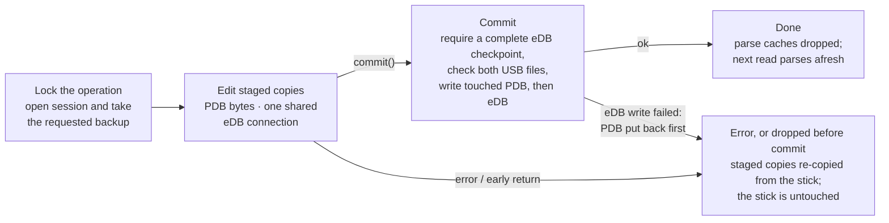
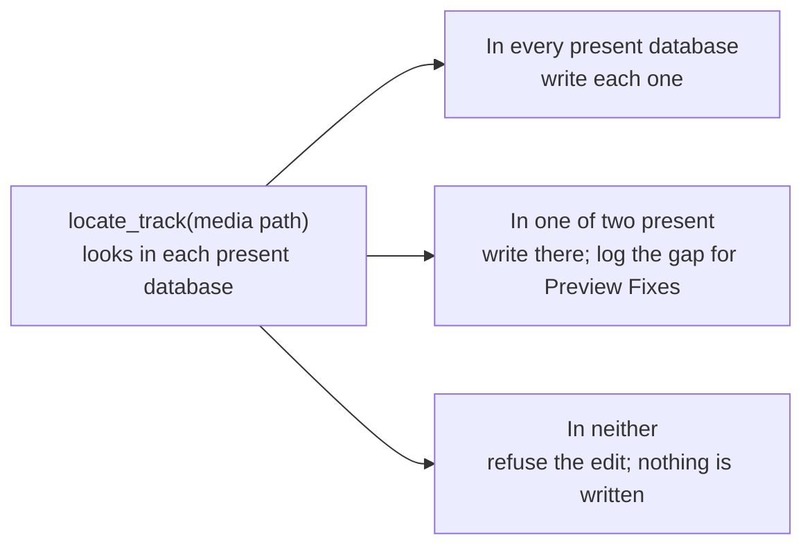

# App Data Flow

How a request from the UI reaches the stick's two databases. Everything that touches the PDB or
the eDB goes through one layer in `backend/src/service/usb_staging.rs`: it says which databases
the stick has, and every write goes through one locked session with a single commit and rollback.

## The whole path

Readers and writers ask the layer (blue) for staged databases; diagnostics and backups also
inspect the original files on the USB. Database
edits happen in the local staged copies and reach the stick only on commit, after which the
parse caches are dropped. The dashed line is the exception: analysis,
audio and artwork files are written straight to the stick, outside the session.

- **Staged copies** are local copies of the PDB and eDB, one folder per drive. Connecting checks
  both the USB and local signatures and discards dirty copies and leftover WAL data. Clean,
  unchanged copies can be reused. After connecting, passive reads trust the staged copies;
  the commit checks the USB for external changes, including deleted or newly created databases.
- **Parse caches** (parsed PDB, eDB library, playlists, track sizes) are keyed by the staged
  files' signatures.
- **`rebuild_missing_database`** is the strict parity repair's rebuild of the database a stick
  lacks. Export calls it; repair uses the same strict-parity implementation inside its session.
- **The Engine DJ library** (`m.db`) is built from the PDB and the eDB merged: a track or playlist
  in both comes from the PDB, and what only one has is added. On a one-database stick it is
  built from that database alone, and the other is not created.

## A write session

Every writer runs this same sequence: cue, BPM, key and metadata saves, order edit, playlist
removal, export, repair apply, player menu, background colour, backup restore and initialize USB.
Backup is a session option, taken by the writers that took one before. With staging off (tests),
the session snapshots the stick's files instead and restores those.

The operation holds `usb_write_lock` from its initial database reads through commit and
post-commit work. A reconnect cannot restage the files during a write. Only databases touched
by the current session can be written back. An incomplete WAL checkpoint fails before either
staged database is copied to the USB. Export and playlist removal delete obsolete files only
after the database commit; Engine refresh and export success bookkeeping also follow commit.

If the second database write fails, the first is restored. If that restoration also fails,
the error explicitly reports the partial save and asks for backup recovery. This is rollback
for handled failures, not a crash-atomic transaction across two files. Audio, artwork, analysis
files and the app's own library updates are outside the database rollback.

## Which database a track edit goes to

Cue, BPM, key and metadata saves take this decision from the layer instead of checking files
themselves. A database the stick lacks is not a gap: a PDB-only stick writes only the PDB, with
no warning. Export rebuilds the missing database first, so the stick ends up with both.

Presence comes from `UsbDatabases` (`Both`, `PdbOnly`, `EdbOnly`), worked out from the staged
files on each call rather than cached in a process-wide value. Operations requiring an existing
player database fail with "no player database" when neither exists; browse and initialization
can handle an empty stick.

## Where it lives

| File | What |
| --- | --- |
| `backend/src/service/usb_staging.rs` | `UsbDatabases`, `TrackLocation`, `UsbWriteSession`, staging |
| `backend/src/service/repair/strict_parity.rs` | `rebuild_missing_database` and the shared strict-parity rebuild |
| `backend/src/edb.rs` | eDB reads; `edb_as_parsed_pdb` for PDB-less repair detection and histories |
| `backend/src/service/usb.rs` | connect, browse, histories, playlist removal, parse caches |
| `backend/src/service/export.rs` | export: rebuild if needed, eDB then PDB, one commit |
| `backend/src/service/repair/run.rs` | detection, then apply in one session |
