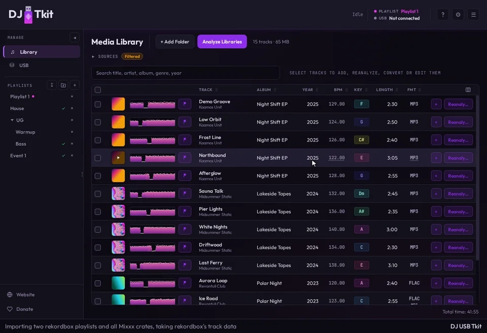

# External Libraries (rekordbox + Mixxx)

## How it works

Besides music folders, the library can take tracks from two DJ applications'
own libraries on the same computer:

- **rekordbox**: the desktop library `master.db`
- **Mixxx**: the library `mixxxdb.sqlite`

Both are found automatically at startup. When one is found, the Media
Library's **Sources** section gets a **Libraries** row (under **Folders**)
with a chip for it: **rekordbox** / **Mixxx**, with an import button (↻, "Import
from rekordbox" / "Import from Mixxx"). The chip's checkbox stays disabled until
that library has been imported. If no music folder has been added yet, the
empty library screen offers the same imports.

Both databases are only ever read. Nothing is written back to rekordbox or
Mixxx, and either application can stay open while importing.

### Importing a library

The chip's ↻ brings every track of that library into the app's library and
turns the chip on:

| | rekordbox | Mixxx |
| --- | --- | --- |
| Title, artist, album | yes | yes |
| Genre | yes | yes |
| BPM, key, length | yes | yes (plus sample rate) |
| Cover image | yes (rekordbox's artwork file) | only a cover image *file* next to the track; embedded covers come from the app's own analysis |
| First beat (beat-grid anchor) | yes, from rekordbox's beat grid | yes, the first beat of Mixxx's beat grid (`BeatGrid-2.0` / `BeatMap-1.0`) |
| Waveform | rekordbox's own analysis files are used in place | no; the app's analysis makes one |
| Hot cues | yes: hot cues (and hot loops) on pads A–H, with colour and name | yes: hot cues and saved loops on pads 1–8, with colour and label; the main cue becomes the playback-start cue |
| Memory cues | yes, every one, with colour and name (see below) | no (Mixxx has none) |

Mixxx stores its waveforms in its own format, so Mixxx tracks need the app's
analysis before export, like any folder track. Only the first beat of a Mixxx
beat grid is used; the app's grid is built from it and the BPM. rekordbox tracks
point at rekordbox's analysis files instead; one that rekordbox never analyzed
(no waveform, BPM or length) gets the app's analysis like any other track.

The first analysis of an imported track keeps the imported BPM and key, so a
tempo or key the DJ corrected in rekordbox or Mixxx isn't lost, and writes
that BPM into the beat grid, starting at the imported first beat. **Reanalyze** on the analyzed track replaces
them with the app's own detection. A BPM you set yourself in the cue editor
behaves the same way. The BPM tooltip shows where the value came from
("From Mixxx", "From rekordbox", "Manually set").

Running an import again updates the tracks already imported:

- Cues, BPM, key and beat grid are taken from rekordbox / Mixxx when the track
  has none, or when its value still came from that library, so a tempo or a
  cue you changed there comes across.
- A value from anywhere else (edited in the app, the app's analysis, the other
  library, a USB stick) is kept when it differs from the library's. After the
  import a dialog lists those tracks and what differs on each ("cues, BPM"),
  with **Keep library's** or **Use rekordbox's / Mixxx's**. Keeping asks again
  on the next import. A grid whose first beat sits a whole number of beats
  away counts as the same grid.
- Length is only filled in when the track has none.
- Title, artist and album follow the library; genre does too when the library
  has one for the track.

The playlist import works the same way, with one dialog per library after all
the ticked lists are imported.

The app's cue list is up to 8 cue points plus one playback-start cue, and
cue points take pads A–H in position order. So an imported hot cue can land on
a different pad letter than in rekordbox or Mixxx if the pads weren't in
position order there.

rekordbox cues are imported like this:

- every hot cue becomes a hot cue
- the earliest memory cue becomes the playback-start cue (where a CDJ's
  auto-cue loads the track) when it comes before the first hot cue (on a
  track without hot cues, when another memory cue follows) and has no name
  or colour
- every other memory cue stays a memory cue, with its name and colour, however
  many there are; one at a hot cue's position is left out, since the hot cue
  already has a memory point there

Tracks imported before memory cues were supported had them turned into cue
points or left out. Importing again and choosing **Use rekordbox's** brings
them back as memory cues.

Some tracks are skipped, with the reason in the Event Log:

- the file isn't found, for example because its drive is unplugged. A track
  imported earlier is kept, with its cues, edits and playlist places; the
  import just doesn't update it
- the file isn't one the library takes, such as a video or a tracker module
  (`.it`, `.xm`, …), the same rule the folder scan uses
- the track was deleted in rekordbox / Mixxx
- the file is a byte-identical copy of a file already in the library (the
  same file in two folders), as with the folder scan: the library keeps one
  track, which a playlist import places instead, and the Event Log names the
  extra copy to delete. Copies the library already holds as separate tracks
  are merged into the one with cues, then the one in more playlists, then
  the oldest

### Source chips

A library's checkbox only filters the library view: it shows or hides that
library's tracks and never re-imports (the ↻ does that). It can only be
turned on once the library has been imported, which the backend reports with
the library's detection (`imported`). The two chips are independent. A track
that is in both libraries shows when either chip is on.

A library's chip turns green, as a folder's does, once every track imported
from it has its waveform, BPM and length (`rekordboxDbFullyAnalyzed` /
`mixxxDbFullyAnalyzed` from `get_library_sources`). **Analyze Library** works
with only a library switched on and no folder: it analyzes that library's
tracks that are missing any of those, keeping what the library brought along.

### Importing a playlist

The Import button (↧) on the sidebar's Playlists heading appears
when either library is found. It opens a checklist with a column per library:

- **rekordbox playlists**, in rekordbox's order. A playlist inside a folder
  shows as `Folder / Name`.
- **rekordbox history**, newest first.
- **Mixxx playlists**, including Auto DJ when it has tracks.
- **Mixxx crates**.
- **Mixxx history** (set logs), newest first.

Only lists with tracks are shown, each with its track count. rekordbox smart
playlists aren't listed, because rekordbox doesn't store their tracks.

Tick any number of lists, from either library, and click **Import**. The box
on a group's heading (Playlists, Crates, History) ticks or unticks every list
in that group; it shows half-ticked when only some are. Each
ticked list becomes a new playlist with the same name and track order (Mixxx
crates have no order, so their tracks are sorted by artist and title). Its
tracks are imported into the library the same way as with the chip's ↻, and
its library's chip is turned on. A rekordbox playlist inside folders goes into
the same folders in the sidebar, found by name or made (a history session goes
to the top level: rekordbox files it by year and month); importing it again
updates it wherever it is now. The lists are imported one after another, in
the checklist's order; one that fails doesn't stop the rest, and the status
line names it. When they are done, the first imported playlist opens. A track
listed twice in a list is added to its playlist once.

An imported playlist's header says where it came from, e.g. `Friday Set (5 tracks, Total time: 14:05) · Imported from
rekordbox`.

If none of the list's tracks can be imported, for example a rekordbox library
from another computer whose file paths don't exist here, no playlist is
created and the status line says why.

**Importing a list again** updates the playlist its first import made instead
of creating another one: its tracks and their order are replaced with the
current ones from rekordbox / Mixxx, its name is kept (even if you renamed it),
and its USB export status is cleared. The checklist says so next to the list,
for example `5 tracks · updates "Friday Set"`.
Changes you made to that playlist in the app are replaced. A playlist you
delete is created again on the next import.

Taking the library's values (**Use rekordbox's / Mixxx's** after an import)
only replaces cues when the library has cues for the track. The analysis files
on the USB follow on the next export, which rebuilds each track's beat grid and
cues from the app's values.

### When both libraries have the same file

Tracks are matched by file path, so a file in both libraries is one track in
the app (and so is an identical copy at another path, see above):

- it carries both source flags and shows when either chip is on
- title, artist and album: whichever import ran last
- BPM, key, grid and cues: the first import fills them in; the other library's
  import asks when its values differ
- length: the first value found is kept
- waveform: rekordbox's analysis file
- cover image: whichever import copied one last

## Deep technical details

### Where the databases are looked for

| Library | Environment override | Locations tried, in order |
| --- | --- | --- |
| rekordbox | `DJUSBTKIT_REKORDBOX_DB_PATH` (the old name `DJUSBTKIT_MASTER_DB_PATH` still works) | macOS `~/Library/Application Support/Pioneer DJ/rekordbox/master.db`, then `~/Library/Application Support/Pioneer/rekordbox/master.db`, then `~/Library/Pioneer/rekordbox/master.db`; Windows `%APPDATA%\Pioneer\rekordbox\master.db` (or the same under `%USERPROFILE%\AppData\Roaming`); Linux, rekordbox under Wine: `drive_c/users/<user>/AppData/Roaming/Pioneer/rekordbox/master.db` in `$WINEPREFIX`, then `~/.wine`, then each Bottles bottle (`~/.local/share/bottles/bottles/*`, or the Flatpak's `~/.var/app/com.usebottles.bottles/data/bottles/bottles/*`) |
| Mixxx | `DJUSBTKIT_MIXXX_DB_PATH` | Linux `~/.mixxx/mixxxdb.sqlite`; macOS `~/Library/Containers/org.mixxx.mixxx/Data/Library/Application Support/Mixxx/mixxxdb.sqlite`, then `~/Library/Application Support/Mixxx/mixxxdb.sqlite`; Windows `%LOCALAPPDATA%\Mixxx\mixxxdb.sqlite` |

A `master.db` inside a Wine prefix (a folder with `dosdevices/`) stores
Windows track paths such as `C:/Users/dj/Music/a.mp3` or
`Z:/home/dj/Music/a.mp3`. Each is mapped to a Linux path through the prefix's
drive link (`dosdevices/c:` → `drive_c`, `z:` → `/`), so `Z:/home/dj/...`
becomes `/home/dj/...`, the same path a folder scan finds. A path on a drive
the prefix doesn't map is kept as it is and the track is reported as not
found. This also applies when the environment override points into a prefix.
See `backend/src/service/wine_paths.rs`.

`master.db` is SQLCipher-encrypted with rekordbox's fixed desktop key.
`mixxxdb.sqlite` is plain SQLite. Both are opened with
`SQLITE_OPEN_READ_ONLY`.

### Code layout

- `backend/src/service/rekordbox_import.rs`: `scan_rekordbox_db`,
  `list_rekordbox_playlists`, `import_rekordbox_playlist`
- `backend/src/service/mixxx_import.rs`: `detect_external_mixxx_db`,
  `scan_mixxx_db`, `list_mixxx_playlists`, `import_mixxx_playlist`
- `backend/src/service/playlists.rs`: `import_external_playlists`, the
  command the playlist import dialog calls, running the two above per list
- `backend/src/service/import_conflicts.rs`: which values differ in a way the
  user decides (`differing_fields`), what happens to a track's cues
  (`cue_action`), the dialog's question (`ImportConflicts`), and
  `apply_external_track_data`, the dialog's "Use …", which imports the listed
  tracks again with `force` set

Each module has one per-track importer (`RekordboxTrackImporter`,
`MixxxTrackImporter`) that the whole-library import and the playlist import
share, so a track is treated the same whichever way it arrives. The playlist
import runs in one transaction; when it finds no importable track it returns
an error before creating the playlist, which also rolls back the track
upserts.

`playlists.import_source` records where an imported playlist came from, as
`<library>:<kind>:<id>` (for example `mixxx:crate:4`; Mixxx playlist and crate
ids overlap). The list commands return the matching local playlist as
`existingPlaylist`, and an import saves into it (`save_imported_playlist`).

`tracks.rekordbox_db_source` and `tracks.mixxx_db_source` record where a track
came from. An import that fills in a track's BPM, key or first beat sets
`bpm_analyzer` / `tonality_source` / `first_beat_ms_source` to `rekordbox` or
`mixxx` (a cue-editor edit sets `user`), only over a value that is missing or
came from the same library, unless forced. `tracks.cue_source` does the same
for the cue list (`rekordbox`, `mixxx`, `usb` for cues read from a stick,
`user`); `NULL` is a track whose cues predate it, and an import that finds them
equal to the library's records that library as their source. `analysis::kept_analysis_values` keeps a value with one of those
sources when the track has no waveform yet (its first analysis); a track that
already has one is reanalyzed and gets the detected values. Each library's
chip switch is stored by the backend (`set_external_library_enabled`, read
back through `get_library_sources`); the library commands include a track
from an imported library when `(rekordboxDbEnabled && rekordboxDbSource) ||
(mixxxDbEnabled && mixxxDbSource)`.

### rekordbox `master.db` fields read

- Tracks: `djmdContent` (text `ID`; `FolderPath` is the full file path;
  `BPM` is centi-BPM; `Length` in seconds), joined to `djmdArtist`,
  `djmdAlbum`, `djmdKey.ScaleName` and (when the schema has it)
  `djmdGenre.Name` via `GenreID`. `AnalysisDataPath` / `ImagePath` are
  `/PIONEER/...` paths under rekordbox's `share` folder.
- Playlists: `djmdPlaylist` (`Attribute` 0 = playlist, 1 = folder,
  4 = smart playlist; top level has `ParentID = 'root'`; ordered by `Seq`)
  and `djmdSongPlaylist` (`PlaylistID`, `ContentID`, ordered by `TrackNo`).
- Cues: `djmdCue` (`ContentID`, `InMsec` in milliseconds, `Comment`,
  `ColorTableIndex`). `Kind` 0 is a memory cue and hot-cue pads A–H are
  `Kind` 1, 2, 3, 5, 6, 7, 8, 9 (rekordbox skips 4). Hot cues become hot
  cues; the earliest memory cue becomes the playback-start cue when it lies
  before the first hot cue (with no hot cues, when another memory cue
  follows) and has no name or colour; the other memory cues
  become memory cues, and one at a hot cue's position is dropped
  (`rekordbox_cues_to_track_cues`). `ColorTableIndex` is read with the same codes the
  app writes to the USB eDB's `cue.colorTableIndex` (its palette ids 1–8);
  for a hot cue, unset or other values get the default colour; a memory cue
  stays uncoloured. Colours set in rekordbox are
  not yet validated against real data.
- History: `djmdHistory` (sessions are `Attribute` 0 under year / month
  folders; newest first by `DateCreated`) and `djmdSongHistory`
  (`HistoryID`, `ContentID`, `TrackNo`).
- Rows with `rb_local_deleted = 1` are ignored everywhere.

### Mixxx `mixxxdb.sqlite` fields read

- Tracks: `library` joined to `track_locations` on `library.location`;
  rows with `library.mixxx_deleted` or `track_locations.fs_deleted` set are
  ignored. `duration` is in seconds, `bpm` a float; `genre` is read when the
  column exists.
- Key: `library.key_id` is Mixxx's ChromaticKey (1–12 = C..B major, 13–24 =
  Cm..Bm minor), mapped to the app's classic key names. When it's unset, the
  `key` text is used if it's a key the app recognises; Mixxx writes that text
  in the user's chosen notation (`Am`, `8A`, `1m`, …).
- Cover: `coverart_type = 2` (file) with `coverart_location` relative to the
  track's folder (or absolute). Embedded covers (`coverart_type = 1`) are
  left to analysis.
- Cues: `cues.type` 1 (hot cue) and 4 (saved loop) with `hotcue >= 0`
  become cue points, at most 8. With more pads set, the lowest-numbered
  pads (`hotcue` 0-7 = pads 1-8) win; the kept cues are ordered by position,
  one per position. Type 2 (main cue) becomes the playback-start cue when it lies
  before the first hot cue. Intro, outro and other markers are ignored.
  `position` is in interleaved stereo samples:
  `ms = position / (2 × samplerate) × 1000`. `color` (`0xRRGGBB`) maps to the
  nearest colour of the app's cue palette.
- Playlists: `Playlists.hidden` 0 = playlist, 1 = Auto DJ, 2 = history set
  log (others, such as the history placeholder, are skipped), with
  `PlaylistTracks` ordered by `position`. Crates: `crates` +
  `crate_tracks`.
- Columns that older Mixxx versions lack (`key_id`, `coverart_*`,
  `mixxx_deleted`, `fs_deleted`) are read as `NULL`.

Validated against Mixxx 2.5.6 and a rekordbox 6 `master.db`.
