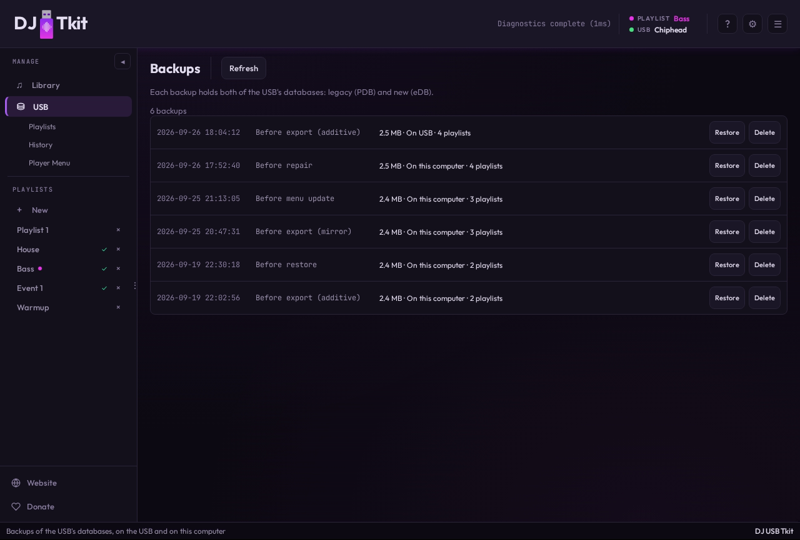

# USB Backups

Before every USB-mutating operation — export, playlist reorder, playlist removal, repair apply,
and player-menu config changes, not just export — the app copies the live PDB and eDB to a
backups folder next to them with a shared timestamp, e.g. `export_2025-04-23_14-32-01.pdb` and
`exportLibrary_2025-04-23_14-32-01.db`. Files are only copied if they already exist — a first
export with no prior databases skips silently. For export specifically, this behavior is on by
default and can be disabled in Settings → Export Settings (`backupBeforeExport`); the other
operations always back up first, unconditionally. Backup always runs before any database write is
attempted, regardless of whether local staging ([USB_EXPORT.md](USB_EXPORT.md), "Local HDD
staging") is active, so it captures the drive's actual pre-write state either way.

Since PDB and eDB are always backed up together under one shared timestamp, each backup event is
one logical snapshot covering both files.

Only the newest snapshot per file stays in `PIONEER/rekordbox/backups/` on the USB drive itself —
that single restore point travels with the physical drive to any computer. Older snapshots are
moved to the local HDD staging cache (`usb_staging::backups_dir_for`, under the same
per-device cache directory, see [USB_EXPORT.md](USB_EXPORT.md), "Local HDD staging") instead of
accumulating forever on the (often space-constrained) USB stick. This archiving requires a named drive: an unnamed drive has no
stable cache directory yet, so everything is left on the USB until it's named. Total snapshots
kept (USB + cache, combined) is capped by a user-configurable retention count in Settings
(default 10; oldest cache-side snapshots are pruned first once the cap is exceeded).

Backups are managed through a dedicated **Backups** panel (the **Backups** button on the USB page): it lists
every snapshot (bundling each timestamp's PDB+eDB pair into one "eDB and PDB" row, tagged with
whether it currently lives on the USB or in the local cache), and lets the user restore or delete
a snapshot. Restoring or deleting acts on both files in the pair at once. Restoring first backs up
the current live state (protected from that same reconcile pass so it can't prune the very
snapshot being restored from), then copies the snapshot's files over the live PDB/eDB.

Implementation: `backend/src/service/usb_backups.rs` (list/restore/delete + retention/archival
policy), `backend/src/service/usb_vendor_compat.rs` (`backup_usb_databases`, the raw timestamped
copy every mutating operation calls through `backup_usb_databases_with_retention`).
