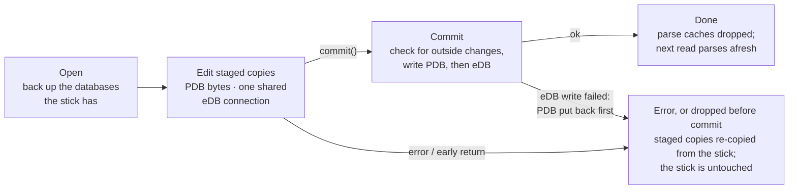
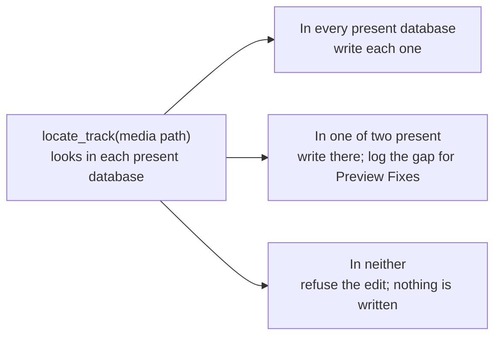

# USB Data Flow

How a request from the UI reaches the stick's two databases. Everything that touches the PDB or
the eDB goes through one layer in `backend/src/service/usb_staging.rs`: it says which databases
the stick has, and every write goes through one session that saves both databases or neither.

## The whole path

Readers and writers never pick a database file themselves; they ask the layer (blue). Database
edits happen in the local staged copies and reach the stick only on commit, both databases or
neither, after which the parse caches are dropped. The dashed line is the exception: analysis,
audio and artwork files are written straight to the stick, outside the session.

- **Staged copies** are local copies of the PDB and eDB, one folder per drive. Connecting copies
  them in again; later reads copy only when the stick's file has changed.
- **Parse caches** (parsed PDB, eDB library, playlists, track sizes) are keyed by the staged
  files' signatures.
- **`rebuild_missing_database`** is the strict parity repair's rebuild of the database a stick
  lacks. Export and repair call it, inside their write session.
- **The Engine DJ library** (`m.db`) is built from the PDB and the eDB merged: a track or playlist
  in both comes from the PDB, and what only one has is added. On a one-database stick it is
  built from that database alone, and the other is not created.

## A write session

Every writer runs this same sequence: cue, BPM, key and metadata saves, order edit, playlist
removal, export, repair apply, player menu, background colour, backup restore and initialize USB.
Backup is a session option, taken by the writers that took one before. With staging off (tests),
the session snapshots the stick's files instead and restores those.

## Which database a track edit goes to

Cue, BPM, key and metadata saves take this decision from the layer instead of checking files
themselves. A database the stick lacks is not a gap: a PDB-only stick writes only the PDB, with
no warning. Export rebuilds the missing database first, so the stick ends up with both.

Presence comes from `UsbDatabases` (`Both`, `PdbOnly`, `EdbOnly`), worked out from the staged
files on each call rather than cached in a process-wide value. A stick with neither database
fails with "no player database".

## Where it lives

| File | What |
| --- | --- |
| `backend/src/service/usb_staging.rs` | `UsbDatabases`, `TrackLocation`, `UsbWriteSession`, staging |
| `backend/src/service/repair/strict_parity.rs` | `rebuild_missing_database`, the one rebuild entry point |
| `backend/src/edb.rs` | eDB reads; `edb_as_parsed_pdb` for PDB-less repair detection and histories |
| `backend/src/service/usb.rs` | connect, browse, histories, playlist removal, parse caches |
| `backend/src/service/export.rs` | export: rebuild if needed, eDB then PDB, one commit |
| `backend/src/service/repair/run.rs` | detection, then apply in one session |
