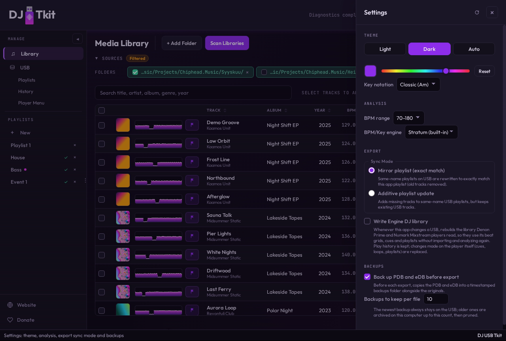
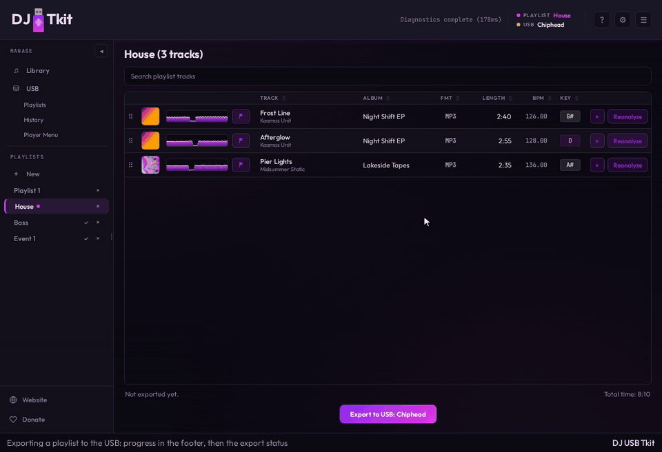
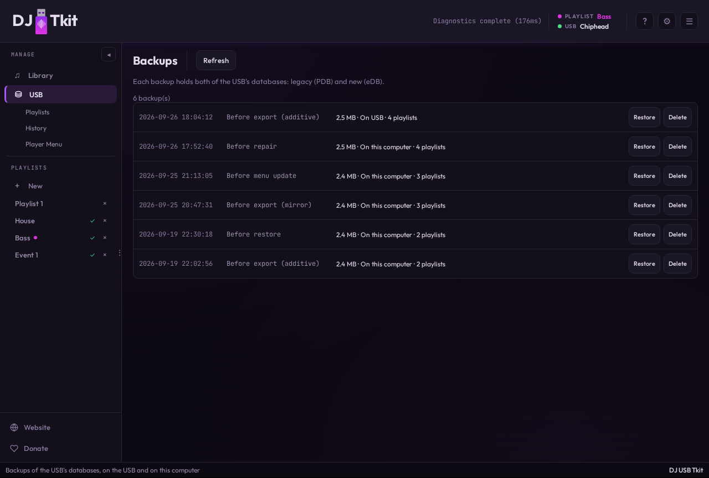
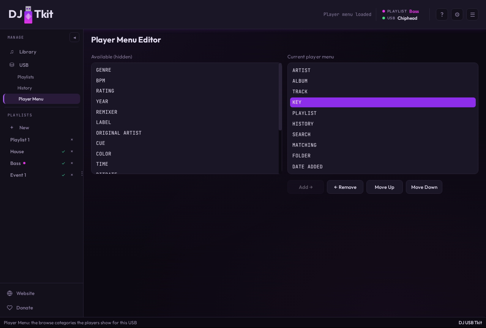

# USB Export

## How it works

Export goes to the selected USB; see [USB_CONNECT.md](USB_CONNECT.md) for selecting one, what the
playlist page shows while it's connected, and why Export is disabled while an export runs.

USB export writes selected local playlist content into DJ-player-compatible USB structures. The export path includes media copies, playlist membership, and analysis/artwork references required for player compatibility.

Export supports two playlist sync modes:

- `mirror`: exported playlist membership on USB is replaced with the current local playlist membership.
- `additive`: exported tracks are added to existing USB playlist membership without removing existing members.

In practical terms:

- use `mirror` when you want the USB playlist to exactly match the current local playlist
- use `additive` when you want to keep existing USB playlist members and only append missing local members
- both modes affect only the exported playlist target; unrelated playlists are left as-is

The sync mode and the backup-before-export option are in Settings:

Settings → Export also has "Write Engine DJ library", which is off by default.
With it on, every export (and every other change to the stick's rekordbox data)
also rebuilds the Engine DJ library on the USB, so Denon and Numark players
use the app's beat grids and waveforms instead of analyzing each track again.
See [ENGINE_DJ.md](ENGINE_DJ.md).

Export is intentionally tied to a quick prep loop:

- users can prepare playlists first
- analyze only missing tracks for that playlist
- then export once required analysis fields are present

Export is designed for deterministic re-runs. Re-exporting the same playlist should produce predictable results, and optional cleanup can prune stale export-owned files when enabled.

Each export also records local bookkeeping for the selected USB device. The
backend updates the `usb_devices` row for the root and appends a
`usb_device_exports` record with playlist name, export timestamp, track count,
and track fingerprints. This history is local app state; it does not change
the player-visible USB database.

## Backup

Before every USB-mutating operation — export, playlist reorder, playlist removal, repair apply,
and player-menu config changes, not just export — the app copies the live PDB and eDB to a
backups folder next to them with a shared timestamp, e.g. `export_2025-04-23_14-32-01.pdb` and
`exportLibrary_2025-04-23_14-32-01.db`. Files are only copied if they already exist — a first
export with no prior databases skips silently. For export specifically, this behavior is on by
default and can be disabled in Settings → Export Settings (`backupBeforeExport`); the other
operations always back up first, unconditionally. Backup always runs before any database write is
attempted, regardless of whether local staging (below) is active, so it captures the drive's
actual pre-write state either way.

Since PDB and eDB are always backed up together under one shared timestamp, each backup event is
one logical snapshot covering both files.

Only the newest snapshot per file stays in `PIONEER/rekordbox/backups/` on the USB drive itself —
that single restore point travels with the physical drive to any computer. Older snapshots are
moved to the local HDD staging cache (`usb_staging::backups_dir_for`, under the same
per-device cache directory described below) instead of accumulating forever on the (often
space-constrained) USB stick. This archiving requires a named drive: an unnamed drive has no
stable cache directory yet, so everything is left on the USB until it's named. Total snapshots
kept (USB + cache, combined) is capped by a user-configurable retention count in Settings
(default 10; oldest cache-side snapshots are pruned first once the cap is exceeded).

Backups are managed through a dedicated **Backups** panel (the **Backups** button on the USB page): it lists
every snapshot (bundling each timestamp's PDB+eDB pair into one "eDB and PDB" row, tagged with
whether it currently lives on the USB or in the local cache), and lets the user restore or delete
a snapshot. Restoring or deleting acts on both files in the pair at once. Restoring first backs up
the current live state (protected from that same reconcile pass so it can't prune the very
snapshot being restored from), then copies the snapshot's files over the live PDB/eDB.

Implementation: `backend/src/service/usb_backups.rs` (list/restore/delete + retention/archival
policy), `backend/src/service/usb_vendor_compat.rs` (`backup_usb_databases`, the raw timestamped
copy every mutating operation calls through `backup_usb_databases_with_retention`).

Strict parity validation is handled as a separate diagnostics surface so users can distinguish between operationally usable media and strict database parity.

## Local HDD staging

`export.pdb` and `exportLibrary.db` are staged to a local working copy under the desktop app's
data directory (`usb_cache/<device-key>/PIONEER/rekordbox/...`) instead of being read directly off
the USB mount on every call. Selecting a USB (`validate_usb_root`) checks each file against the
drive once: it's copied locally when its size/mtime differ from the last copy, and the last copy is
reused otherwise. For the rest of that connect, reads trust the local copy without touching the
USB mount again, so a change made to the drive by something else meanwhile is only picked up by
selecting the USB again (and blocks the next write-back, below). Writes go to the local copy
first and are committed back to the drive only if the local copy actually changed, via an atomic
temp-file-plus-rename so a crash or drive removal mid-write can't leave a half-written database on
the USB.

`<device-key>` is the slugged form of the drive's user-assigned name (see "USB drive naming"
below) when the drive has one, so the same physical drive reuses the same cache directory
regardless of which port or computer's mount path the OS assigns it this time. An unnamed drive
falls back to a hash of its (unstable) mount path, prefixed `unnamed-` so the two key spaces can
never collide; that fallback is also why backup archiving (above) and naming-dependent features
require a named drive.

This is the desktop app's behavior specifically — it's the only context that enables staging, at
startup, right after the backend is constructed (`usb_staging::init_cache_root` in
`desktop/src-tauri/src/main.rs`). CLI dev tools (`backend/src/bin/*.rs`) and the automated test
suite never enable it, so they keep reading/writing the given path directly, matching behavior
from before staging existed.

USB repair reads and writes through the same staging layer (see `docs/DIAGNOSTICS_REPAIRS.md`).
Every fix selected in one apply request is written to the local copy first; the batch is flushed
back to the USB drive once, at the end of the apply, rather than once per fix. The player-menu
editor (`update_usb_player_menu_config`/`sync_usb_player_menu_edb_to_pdb`) is staged the same way,
each as its own standalone backup-then-write-then-flush.

The Event Log records the local staging folder path the first time it's created for a device,
plus each individual stage-copy and write-back, so it's easy to find the working folder if you
want to inspect it directly.

If the drive's copy of a file changes between when it was staged and when a write-back is about
to commit — e.g. Rekordbox itself wrote to the drive in between — the write-back is aborted with
an error instead of silently overwriting that external change; re-opening the USB re-syncs the
local copy and the operation can be retried.

Implementation: `backend/src/service/usb_staging.rs` (staging/write-back core),
`backend/src/edb.rs` (`open_edb_from_usb_root`/`open_edb_rw` route eDB access through it
transparently), `backend/src/service/usb_utils.rs` (`parse_staged_pdb` wraps `pdb_reader::parse_pdb`
for PDB reads).

## USB drive naming

Drives have no app-visible hardware serial/UUID — `resolve_usb_root` accepts any directory, not
just a real removable device — so identity is instead a name the user assigns. The app prompts
for a name the first time a valid, unnamed drive is connected; "Not now" leaves it unnamed, and
the drive name in the header names or renames the connected drive at any time. The name is stored
in a small marker file (`.dj-usb-tkit/drive.json`) written next to `PIONEER/` on the drive itself
(untouched by Rekordbox and by this app's own validation/repair scans). Because the marker file
travels with the drive, the same physical stick keeps its identity across replugs, different USB
ports, and even different computers — what the local HDD staging cache key (above) and backup
archiving (above) both depend on for stability.

Every eDB write (export and the repairs that write playlists) also sets the eDB's
`property.deviceName` to the drive name, the field rekordbox shows the drive under. A drive with
no name of its own (unnamed, or carrying another drive's name) keeps whatever is there, such as
a name set in rekordbox. The PDB's `t19` rows can carry the name too; the app leaves them as
they are.

Locally, two tables mirror it:

- `usb_drive_names` is the uniqueness index: one row per name in use, keyed by the name's slug
  (the cache/backup key), so "My USB" and "my-usb" are the same name. It is not keyed by mount
  path: sticks with the same volume label usually mount at the same path, and each needs its own
  name. A name read from a drive's marker joins it on connect, so drives named on another computer
  count as taken too. Removing a drive from the recent list frees its name.
- `usb_devices.label` is the name last seen at a mount path, shown for a drive that isn't plugged
  in. It is never read back as a drive's name: a drive without a marker is unnamed.

Renaming moves the drive's HDD cache directory (staged databases and archived backups) to the new
name's key and frees the old name.

### Copies of a named drive

A copied stick or folder carries the original's marker. On every connect, before the databases
are staged, `check_drive_identity` compares the drive with what `usb_drive_names` remembers about
the drive holding that name:

- `total_bytes`: the drive's size (for a folder, its disk's). A different size means a different
  drive.
- `last_export_at`: the `exportedAt` of the last export this computer logged on that drive (set
  only once the export log record is written; seeded from `usb_device_exports` when the column is
  added). If the connected drive's export log lacks that record, it's a different drive. Exports
  from other computers only add records, so they never trip this; an unreadable log is ignored.

A drive that fails either check counts as unnamed for the rest of the session
(`usb_identity::drive_name`): it stages into its own cache, its backups stay on the USB, and it
isn't labelled with the other drive's name. The naming prompt says which name it carries, and the
OS label isn't suggested when it is that name. Giving it a new name makes it a drive of its own.
Giving it the carried name again makes it the drive that name is checked against (for a drive
that is the original after all, e.g. after a partition resize). An identical copy on a
same-size stick can't be told apart until one of the two gets an export; until then the two hold
the same content, so sharing the cache is harmless.

If the folder the user selected is on an actual removable USB device, the drive's own filesystem
volume label is read and pre-filled into the naming prompt as a suggestion (`GetVolumeInformationW`
on Windows, DiskArbitration via the `sysinfo` crate on macOS, `/dev/disk/by-label` on Linux,
matched by walking `/proc/mounts` for the longest mount-point prefix and confirming the underlying
device has a `usb-*` entry under `/dev/disk/by-id/`). The user can still edit or replace the
suggestion before saving; an arbitrary local directory that isn't backed by a removable device
gets no suggestion.

Implementation: `backend/src/service/usb_identity.rs`, `check_drive_identity` and
`set_usb_device_name` in `backend/src/service/usb.rs`.

## Deep technical details

Export is a coordinated write pipeline, not a single file copy. For each export operation, the backend prepares playlist membership, track metadata, and file-path mappings, then writes both database surfaces (PDB and eDB) plus filesystem assets under the expected USB tree.

For full field inventories and mapping notes, see `docs/PDB.md` and `docs/eDB.md`.

Known DB data written by export:

- eDB is the richer relational surface and is used for:
  - playlist rows (`playlist`)
  - ordered membership rows (`playlist_content`)
  - track metadata rows (`content`)
  - artwork lookup rows (`image`) and linked references
  - menu/category/sort/property baseline tables during USB initialization
  - history tables when present and synchronized by explicit flows
- PDB is the binary player-oriented surface and is used for:
  - track rows including core playback metadata and file/analysis paths
  - playlist tree and playlist-entry tables for hardware-visible playlist order
  - artwork/dictionary references used by track rows
  - history/runtime tables when already present or when first-export runtime
    rows must be synthesized in place

Known PDB track-row data currently mapped in export includes:

- core numeric fields: track ID, artist/album/key IDs, artwork ID, track number, tempo (`tempo_x100`), duration, file size, sample rate, bitrate, and app-owned identity fields (`master_db_id`, `master_content_id`, `content_link`)
- string-slot data: title, media path, analysis path range, export date (`date_added`), release date policy value, and other structural slots preserved for compatibility

Known eDB track-row data currently mapped in export includes:

- `content.length` from local `duration_ms` (seconds)
- `content.dateAdded` from export run day
- `content.dateCreated` fallback chain (`recorded_date` -> `release_date` -> file timestamp)
- `content.releaseDate` and the PDB release-date slot: the full `release_date` tag, else the
  file timestamp. When the tags carry only a year (or year and month) and the file timestamp
  falls outside it, the start of that year (or month) is used instead
- `content.releaseYear` and the PDB release-year field: the year tag, else the year of the
  release date above, so year and date always agree
- the file timestamp is the earlier of the source file's creation and modification time
  (whichever the OS provides); unzipping keeps the archive's modification time while a later
  tag edit bumps it, so the earlier one is the closest the file gets to the release
- `content.analysisDataFilePath`, media path, artwork linkage, and identity fields

Before writing exporter-owned metadata text, the exporter strips embedded NUL
bytes, caps any grapheme cluster (a base character plus its combining marks)
to 8 codepoints, caps the number of distinct Unicode scripts a single string
may mix to 3, and truncates to 255 Unicode characters. This applies to
playlist names, track title/subtitle/search/comment/KUVO-comment text, and
artist/album/genre metadata. It does not apply this metadata sanitizer to
key/tonality strings, media paths, or analysis paths.

The grapheme-cluster cap exists because "zalgo" text — dozens to hundreds of
Unicode combining marks stacked on one base character — has been observed to
hang CDJ hardware when it tries to render the track title, even though the
total character count is well under the 255-character limit. The
script-diversity cap exists because a separate, shallower pathological case
was also observed to hang CDJ hardware: a name mixing many unrelated scripts
(e.g. Braille, Yi, Georgian, Tibetan, Tamil, Bengali, Arabic all in ~25
characters) hung both the CDJ's Artist browse menu and its track-load screen,
even though no individual grapheme cluster was deep enough to trip the
combining-mark cap. Rather than curating a list of which scripts are "safe"
CDJ hardware can render, the cap is purely self-referential: once a string
has touched `MAX_DISTINCT_SCRIPTS` distinct scripts, characters belonging to
any further script are dropped — the allowed set is just whichever scripts
the string happens to touch first. Script-neutral characters (punctuation,
digits, combining marks that inherit their base's script) never count against
the budget.

Both caps are applied to the on-disk `/Contents/...` file and folder names the
exporter generates (see `sanitize_contents_component` in `export_paths.rs`),
since that text is also embedded verbatim in the ANLZ `PPTH` chunk written
into the waveform/beatgrid bundle (see `docs/WAVEFORMS.md`). Neither cap is
applied to the literal media path used to read the audio file itself — that
must always match the real file on disk.

The main technical stages are:

1. Resolve export target and selected playlist content.
2. Ensure required local analysis/artwork/media references exist or report missing prerequisites.
3. Copy/update media and related assets into expected USB paths.
4. Write playlist/track metadata into PDB and eDB.
5. Emit progress and warnings through the job event model.

If playlist tracks are missing required analysis, export is blocked and UI instructs the user to run "Analyze Missing Tracks" for that playlist before retrying export.

Analysis bundle handling is copy-only during export. Export requires the track to already have a `DAT` + `EXT` bundle (plus `2EX` when one exists; rekordbox bundles from older analyses have none) and copies/reuses it even if the bundle is older or low-detail. Export does not decode source audio or regenerate ANLZ files; missing bundle files block export before media copy starts. See `docs/WAVEFORMS.md`.

On the USB the bundle goes into `PIONEER/USBANLZ/Pnnn/<hash>/`, the folder hashed
from the track's USB path. When two tracks' paths hash to the same folder, the
second gets `ANLZ0001` (the third `ANLZ0002`, and so on), each with a `PPTH`
naming its own track, as rekordbox does; export never reuses a bundle whose
`PPTH` names another track. See "Analysis File Ownership" in
`docs/DIAGNOSTICS_REPAIRS.md`.

**Cue points and edited beat grids** are the one exception to copy-only: when a
track has rows in `track_cues` or a user-set `first_beat_ms`, the copied
`.DAT` / `.EXT` are passed through `apply_analysis_edits_to_anlz` (after the
`PPTH` injection) so the exported bundle carries the current cue list and beat
grid — including on the "reuse an on-USB bundle" retain path
(`ensure_analysis_bundle_ppth`). **Each hot cue is written twice**: a memory
point (`PCPT`/`PCP2` with `hot_cue = 0`) and a hot-cue pad (`hot_cue = 1..8` by
position order), so a CDJ surfaces it both in the CALL/memory list and on a pad.
The optional **playback-start cue** (`is_playback_start`) is the exception: it
is written once, as a memory point only, before the hot cues, so the CDJ loads
the track there instead of on cue A. It is dropped when it coincides with a hot
cue (see `docs/CUE_EDITOR.md`). Each **memory cue** (`is_memory`) is also written
once, as a memory point with its own name and colour (`hot_cue = 0`).
In the eDB, `write_edb_cues_for_content` replaces the `cue` rows for the track's
`content_id` with **two rows per hot cue** (`kind = 0` memory /
`kind = 1` hot; one `kind = 0` row for the playback-start cue and for each
memory cue; `inUsec = position_ms × 1000`, `colorTableIndex` = palette index
for the hot row and a memory cue's row (`-1` when uncoloured) / `-1` for a hot
cue's memory row and the start cue's; MPEG/decoder seek fields left `0` — the
player recomputes them), bumps `content.cueUpdateCount`, and sets
`isHotCueAutoLoadOn`. `hotCueBankList` is intentionally left empty. In the PDB
the `autoload_hotcues` flag is already written `ON` for every exported track.
Unedited tracks are byte-identical to before (empty `PCOB`/`PCO2` placeholders,
`cueUpdateCount` untouched).

WAV media copy has one exception to plain byte-for-byte copying: if a source WAV's `fmt ` chunk uses `WAVE_FORMAT_EXTENSIBLE` and wraps plain PCM or IEEE-float data (flagged during scan — see `docs/LIBRARY_ANALYSIS.md`), export rewrites the header to a standard 16-byte PCM/float `fmt ` chunk before writing it to the USB drive, since some Pioneer CDJs reject the extensible form outright. This is a lossless, header-only rewrite: only the `fmt ` chunk bytes and the overall RIFF size are changed, sample data is streamed through unmodified. If the extensible header wraps some other subformat, there's nothing safe to rewrite and the file is copied unchanged (`copy_if_different`), keeping the hard warning from scan surfaced in the UI. See `backend/src/wav_format.rs` (`rewrite_extensible_to_pcm`) and `copy_wav_normalized_if_needed` in `export_paths.rs`.

Current media-copy behavior is intentionally conservative: file copy/write steps
are sequential per export operation. This keeps ordering deterministic and
failure handling straightforward across USB devices.

### Mirror vs additive behavior

Mirror and additive are the same export path with one boolean flipped
(`pruneStale` / `mirror_playlist_entries`). Both run through the same manifest
build, the same eDB writer (`write_edb_playlist`) and PDB writer (`write_pdb`),
and the same page/footer conventions; for a USB that already has a PDB, both take
the topology-locked in-place additive patch and neither falls back to a full PDB
rebuild. The resulting databases are the same shape, and both are expected to
pass the strict parity report — the 0.1.32 fixes closed the last case where a
mirror drop left eDB `content` / PDB `tt=0` rows behind after their file was
pruned (which strict raw-coverage parity flagged as "indexed audio file(s)
missing from USB").

They differ only in:

- **Membership** — mirror replaces the target playlist's existing USB membership
  with the local playlist; additive unions the two (new local tracks appended,
  tracks already on the USB kept).
- **Entry order** — mirror writes entry order from the local playlist; additive
  keeps the existing on-USB order and appends new tracks after it.
- **Pruning** — only mirror deletes anything (stale export-owned files, plus the
  eDB/PDB rows for tracks dropped from the playlist and referenced nowhere else).
  Additive never removes a row or a file.

The mechanics of each difference:

- Mirror mode (`pruneStale = true`):
  - eDB path deletes existing `playlist_content` rows for the target playlist ID before relinking manifest members.
  - PDB path removes target playlist-entry rows in place, preserving table chains and inactive/tombstone state.
  - stale export-owned files from previous runs can be pruned when no longer part of the current manifest.
  - When a track drops out of the exported playlist and the prune step is about to delete its
    media file, the exporter also removes that track's eDB `content` row and PDB `tt=0` track row
    in place (plus any `tt=13` artwork row / eDB `image` row that no other track still uses), so
    the databases don't keep referencing a file that no longer exists. A dropped track is left
    fully intact — row and files — when it is still a member of another USB playlist or is
    referenced by a device play-history entry, matching the guard `remove_playlist_and_tracks_from_pdb`
    and `filter_prunable_stale_paths_for_playlist` use. Track rows are tombstoned with the same
    in-place `remove_rows_inplace` + sentinel-rebuild path as the "remove USB playlist" feature;
    no table chain is relocated.
  - A reused analysis bundle or artwork asset (one this app wrote on an earlier export and is not
    regenerating this run) counts as still owned by the exported playlist for prune purposes, so
    re-exporting an unchanged playlist in mirror mode does not delete its own waveform/artwork
    files.
- Additive mode (`pruneStale = false`):
  - existing playlist membership rows are preserved.
  - new manifest members are linked only when not already present.
  - entry sequencing continues from existing max order instead of resetting.
  - because of this, the app locks drag-reordering of a local playlist's tracks whenever a
    same-named playlist already exists on the connected USB — see "Deep technical details" in
    `docs/PLAYLISTS_PLAYBACK.md`.

Scope is playlist-local in both modes: unrelated playlists are not implicitly rewritten to mirror the exported playlist state.

Existing PDBs are topology-locked. Normal export does not fall back to a full
PDB rebuild, does not call `apply_growth_shape`, and does not rewrite menu
tables. If an export cannot be represented as an in-place additive/mirror patch,
the PDB write fails before commit rather than producing a player-corrupt shape.
For PDB `t07` playlist_tree, new playlist rows are added into existing tail
capacity first, including tombstone-preserving tail pages. When existing
capacity is exhausted, a pure tail append (new pages chained after the
existing last page, with every pre-existing page remaining at its same
position in the chain) is allowed — this is how reference exporters
themselves grow playlist_tree, and multi-page chains are known to work on
hardware. Only a `last_page` change that is not a pure append — page
relocation, reordering, or a broken chain — is rejected.
The exported playlist is placed first in the playlist menu by patching only the
fixed-width `t07.sort_order` fields of active sibling playlist-tree rows. This
matches the intended playlist sibling order while preserving row lengths,
inactive rows, and table-chain topology. eDB `playlist.sequenceNo` is updated to
the same parent-scoped order. Reference exporters follow the same field semantics,
but their ordering comes from the app model and their PDB writers repack from a
static layout rather than preserving arbitrary existing USB topology.
For all reused PDB pages, normal export preserves existing row footer state:
existing `rowpf` and `tranrf` groups are not normalized, and only appended rows
OR in their own row-presence and transaction bits. This is required for
older PDB-first hardware compatibility even when the table topology is unchanged.
Strict-repair metadata fixes use the same path: t00 track rows may receive
direct scalar patches and same-length string-slot patches. When a mapped string
slot grows or shrinks, the old active t00 row is marked inactive and a
replacement row with the same track id is appended to the t00 chain. The
replacement keeps every byte of the old row the change doesn't touch (fixed
fields and string slots the writer doesn't model, such as composer, label and
remixer ids, mix name and message slots); only the changed slots take new
values. Unrelated PDB shape, inactive rows, and menu tables are not normalized.

The PDB writer also writes the composer, label and remixer dictionary ids
(track row offsets 12, 40 and 44), by name, adding label rows as needed.

Dictionary names (artist, album, genre, key, label, remixer, composer) and
artwork paths are matched ignoring case and punctuation. An existing track
keeps its row when that row already names the value, even if another row
matches too ("Drum & Bass" stays on its row rather than moving to a
"drum & Bass" row). Where several existing rows match a new value, the lowest
id wins, so the same input always gives the same PDB. Values are written as
given: blank values are skipped, but surrounding spaces are not trimmed.
A track handed over by a repair (not exported from the library) keeps the
artwork its PDB row already has; only a row without artwork takes the
manifest's.

Existing eDB `content` rows are updated column by column: a column is written
only when the track has a value for it and that value differs from the row's.
A missing or default value never clears the row's own value (a rekordbox
ISRC, release year or key the library doesn't have stays), the album is only
filled in, and the export date fills `dateAdded` only when the row has none.
A re-export of an unchanged track leaves its row as it was. The export's own
bookkeeping (cue rewrite, update counters, `analysedBits`, `hasModified`,
auto-load and KUVO flags) applies only to tracks exported from the library,
not to tracks the strict parity repair or the audio fixes hand the writers.

Deterministic rerun behavior is handled at this pipeline level. Re-exporting the same playlist uses stable identity/linkage rules so metadata and membership can be updated predictably without duplicating entries by default.

Identity-linkage policy is app-owned and persistent:

- one stable `masterDbId` per app data directory
- one stable `masterContentId` per local track
- one stable `contentLink` scope per app data directory

This is intentional: app-exported tracks must keep app-owned identity values so USB-side ANLZ data is resolved from the exported stick for those tracks instead of collapsing resolution to unrelated local cache state.

### Player menu categories

Player browse-category metadata is stored in two related places:

- PDB `columns` table (t16) stores the legacy/player browse-category catalog.
- eDB `menuItem` stores the newer-player category catalog.
- eDB `category` stores the active/visible category subset and order through
  `isVisible` and `sequenceNo`.

The USB view's Player Menu editor shows and changes the visible categories:

App-initialized USBs seed the current 27-row PDB catalog, but existing USBs can
carry smaller or source-specific PDB menu profiles. Normal playlist export
preserves PDB t16/t17/t18 and eDB `menuItem`/`category`/`sort` state exactly.
Menu changes are explicit menu operations, not export side effects.

The Menu Editor's Save action:

1. Resolves the requested active kind list.
2. Rewrites eDB `category` so those kinds are visible in the requested order.
3. Leaves PDB t16 unchanged.
4. If the eDB write fails, eDB is restored from its snapshot.

The PDB restore action is separate: `sync_usb_player_menu_edb_to_pdb` rebuilds
PDB t16 from the full eDB `menuItem` catalog when older app code or manual
editing has removed catalog rows from PDB. See `docs/PDB.md` for the t16 row
layout and observed kind codes.

### Background colour

The player's background (menu highlight) colour is stored in both databases,
and rekordbox lets the two differ:

- PDB: byte 9 of the `t19` (history) rows, read by PDB players such as the
  CDJ-2000NXS2.
- eDB: `property.backGroundColorType`, read by rekordbox.

The values follow rekordbox's list: 0 = default, then 1 pink, 2 red, 3 orange,
4 yellow, 5 green, 6 aqua, 7 blue, 8 purple. `DEVSETTING.DAT` is not involved.

The Player Menu editor has one colour selector for both. A colour is selected
when both databases hold it; when rekordbox left them different, a note names
both, and choosing a colour sets both. `set_usb_background_color` writes the
eDB's `property` row and the PDB's live `t19` page in place, then saves both
to the USB or neither (see `docs/PDB.md`, "`tt=19` background colour"). Export
and repair never change either colour.

Strict parity is intentionally separated from basic export success. A USB may be playable while still failing strict parity checks. The parity report path validates deeper consistency such as:

- playlist membership equivalence across DB surfaces
- duplicate playlist-entry detection
- required metadata presence in PDB-linked rows
- media/analysis path consistency
- dictionary-id resolution integrity (artist/album/key/artwork references)

Strict parity also recognizes a small allowed-difference set where values are app-owned or analysis-path-specific. Current allowed-difference fields are `content.analysisDataFilePath`, `content.contentLink`, `content.masterContentId`, `content.masterDbId`, and `key.name`. Other compared fields are treated as blocking mismatches.

When strict mismatches are found, correction is handled through explicit repair actions rather than silent mutation inside report commands.

Implementation anchors:

- export command façade: `backend/src/commands.rs`
- Tauri export handler: `backend/src/tauri_commands.rs`
- desktop invoke wiring: `desktop/src-tauri/src/main.rs`

## Verification links

- Export behavior: `backend/tests/export_functional.rs`, `backend/tests/export_shape_parity_functional.rs`, `backend/tests/pdb_writer_functional.rs`
- Frontend export flows: `vanilla-ui/tests/usb_export_label.test.mjs`, `vanilla-ui/tests/usb_workflows.test.mjs`
